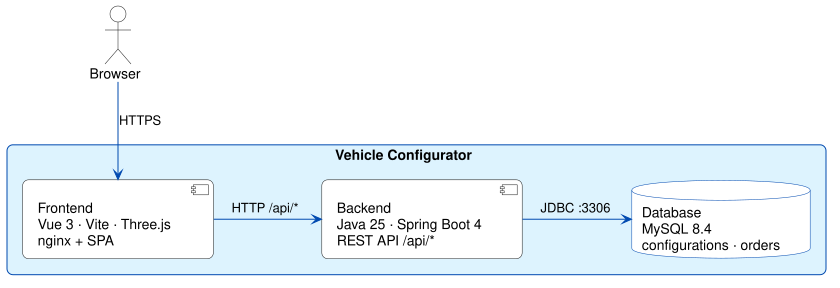

# Vehicle Configurator

**SPA + REST backend** with embedded **SQLite** — two runtime containers, same images locally and in Azure.

**[Live demo](https://frontend.thankfulcliff-8b06d191.westeurope.azurecontainerapps.io/)** · [Architecture](https://github.com/fbrase799/vehicle_configurator/blob/main/ARCHITECTURE.md) · [Source code](https://github.com/fbrase799/vehicle_configurator)

<table>
  <tr>
    <th align="center">Ferrari</th>
    <th align="center">Overview</th>
    <th align="center">Purchase</th>
  </tr>
  <tr>
    <td align="center" width="33%">
      
    </td>
    <td align="center" width="33%">
      
    </td>
    <td align="center" width="33%">
      
    </td>
  </tr>
</table>

## Tech stack

| Layer | Technologies | Highlights |
|-------|--------------|------------|
| **Frontend** | Vue 3, Vite, Three.js | Multi-step configurator, live **3D car preview** (WebGL), real-time price updates, shareable configuration URLs |
| **Backend** | **Java 25**, **Spring Boot 4**, JPA/Hibernate | REST API under `/api/*`, server-side price calculation, UUID-based configurations, transactional order submission |
| **Database** | SQLite (embedded in backend) | Relational catalog, configurations and orders; schema + seed in SQL, applied on first start |
| **Infrastructure** | Docker Compose, Azure Container Apps, GitHub Actions | Two containers (frontend + backend); always-warm cloud demo; CI/CD with OIDC federation |

## Architecture — frontend, backend + embedded database

  

Source: <a href="./assets/diagrams/vehicle-configurator-containers.puml">PlantUML</a>

---

[← Back to profile](./README.md)
